<!-- GENERATED FILE: edit data/ and run scripts/refresh, not this file -->
<a href="https://submitgame.github.io/awesome-ai-game-dev-tools/"></a>

# Awesome AI Game Dev Tools 

> Open-source AI tools for making games, and for **decompiling, remixing and mashing up the games you already own**. Every entry is a GitHub repo with **100+ stars and a push in the last year**, with real star counts pulled from the GitHub API and refreshed daily.

**150 active tools** · 61 inactive · updated 2026-10-19 · browse with tag filters on the **[website](https://submitgame.github.io/awesome-ai-game-dev-tools/)** · data in [`data/tools.json`](data/tools.json)

## Contents

1. [Decompile, remix & mash up games](#1-decompile-remix--mash-up-games)
   - [📚 Learn: Decompile, Remix & Mash Up](#-learn-decompile-remix--mash-up)
   - [a. AI reverse engineering](#1a-ai-reverse-engineering)
   - [b. Decomp & recomp projects](#1b-decomp--recomp-projects)
   - [c. Agent-driven modding](#1c-agent-driven-modding)
   - [d. Mashups & remixes](#1d-mashups--remixes)
   - [e. AI replacement assets](#1e-ai-replacement-assets)
2. [Agents & MCP servers](#2-agents--mcp-servers) (19 + 1 hosted)
3. [Game generation & world models](#3-game-generation--world-models) (10 + 10 hosted)
4. [Code & engines](#4-code--engines) (13)
5. [Art](#5-art) (19 + 6 hosted)
6. [3D, animation & shaders](#6-3d-animation--shaders) (23 + 1 hosted)
7. [Audio](#7-audio) (30)
8. [NPCs & narrative](#8-npcs--narrative) (14)
9. [Testing, QA & analytics](#9-testing-qa--analytics) (5)
10. [Showcase](#10-showcase) (3)
11. [Inactive / unmaintained](#11-inactive--unmaintained) (61)
- [Inclusion rules](#inclusion-rules) · [Sources](#sources) · [Contributing](#contributing) · [License](#license)

## 1. Decompile, remix & mash up games

Point an AI agent at a game you own: read its binary, rebuild it from a decomp, mod it, mash it up with another game, or regenerate its assets.

### 📚 Learn: Decompile, Remix & Mash Up

Explainers, guides and talks, picked by hand. Channel, views and dates are real, as of 2026-10-14 (YouTube video pages via yt-dlp (YouTube Data API quota was exhausted)).

#### Start here (explainers)

| | | By | Views | Date |
|---|---|---|---|---|
|  | **[Has AI Solved Reverse Engineering?](https://youtu.be/wIe3eDfGKUo)** `Video` | Low Level | 1,002,138 | 2026-10-09 |
|  | **[I Tested The Viral Github Repo To Reverse Engineer Anything](https://youtu.be/dAzs_rU6080)** `Video` | Nick Saraev | 958,867 | 2026-10-10 |
|  | **[AI Is Decompiling Every Game \| TheStandup](https://youtu.be/s95Q7D0WR40)** `Video` | The PrimeTime | 315,364 | 2026-10-11 |
|  | **[The AI unlock has begun](https://youtu.be/h5zkzon0gM4)** `Video` | AI Search | 953,260 | 2026-10-06 |
|  | **[AI Agents Are Decompiling Every Video Game](https://youtu.be/rRQzrQLZRWM)** `Video` | Slop Architect | 231,925 | 2026-10-06 |
|  | **[Everything is Open Source Now (Reverse Engineer Anything)](https://youtu.be/jtfpCGsbSJU)** `Video` | Better Stack | 103,793 | 2026-10-12 |
|  | **[AI Game Decompilation: A Deep Dive](https://youtu.be/Pl7ThC4PiVA)** `Video` | Undocumented Behavior | 52,514 | 2026-10-11 |
|  | **[Recomps and Decomps have taken over Retro Gaming...](https://youtu.be/mYZPHdKKMaI)** `Video` | Modern Vintage Gamer | 613,226 | 2026-09-28 |
| <a href="https://youtu.be/cX2kD2yQf88">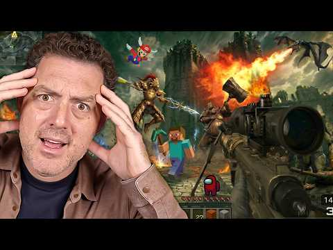</a> | **[Everything has been solved](https://youtu.be/cX2kD2yQf88)** `Video` | Matthew Berman | 246,794 | 2026-10-10 |

#### Mash up games with an agent

| | | By | Views | Date |
|---|---|---|---|---|
| <a href="https://universal-modder.dev">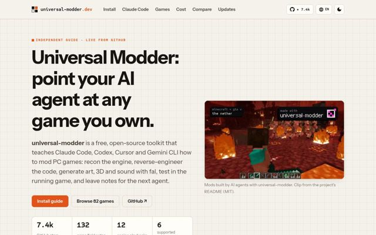</a> | **[universal-modder.dev](https://universal-modder.dev)** `Guide` Project site: install the skills and point your coding agent at a game you own. | universal-modder | | |
| <a href="https://github.com/rehan-remade/universal-modder/tree/HEAD/skills/mashup-mods">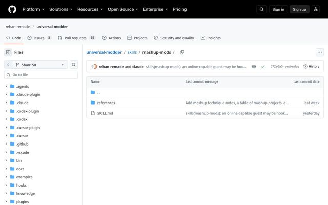</a> | **[skills/mashup-mods](https://github.com/rehan-remade/universal-modder/tree/HEAD/skills/mashup-mods)** `Guide` The agent skill for combining two games: what to bring across and how to wire it in. | universal-modder | | |
| <a href="https://github.com/rehan-remade/universal-modder/tree/HEAD/examples/minecraft-gta5-passthrough">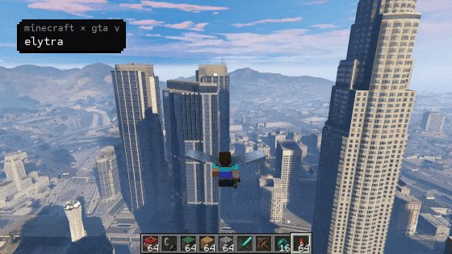</a> | **[examples/minecraft-gta5-passthrough](https://github.com/rehan-remade/universal-modder/tree/HEAD/examples/minecraft-gta5-passthrough)** `Guide` Worked example: real Minecraft depth-composited into GTA V story mode, with field notes. | universal-modder | | |
| <a href="https://huggingface.co/blog/a2aprotocol/universal-modder-a-practical-guide-to-ai-game-modd">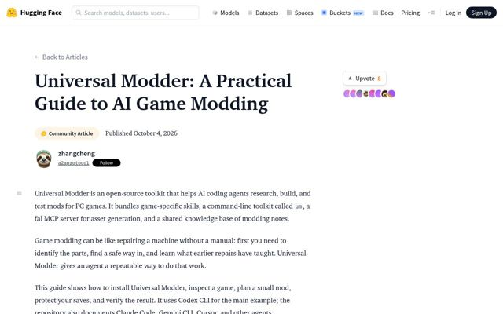</a> | **[Universal Modder: a practical guide to AI game modding](https://huggingface.co/blog/a2aprotocol/universal-modder-a-practical-guide-to-ai-game-modd)** `Guide` Written walkthrough of setting up universal-modder and building a first mod. | Hugging Face blog (a2aprotocol) | | |
|  | **[How To Merge Video Games With AI! (Full Tutorial)](https://youtu.be/jXsB-WMP0d0)** `Video` | Brendan Jowett | 115,225 | 2026-10-06 |
|  | **[Mod Any PC Game with AI Agents 👁️ Universal Modder Breakdown](https://youtu.be/NRBfwTBBD54)** `Video` | LookOnThisGit | 49,301 | 2026-10-02 |
| <a href="https://youtu.be/zDDdbraq42M">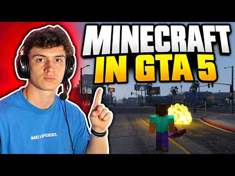</a> | **[How to Play MINECRAFT in GTA 5 (Universal Modder Tutorial)](https://youtu.be/zDDdbraq42M)** `Video` | The Mantis Method | 17,153 | 2026-10-08 |
| <a href="https://youtu.be/9dDJq1LGBAw">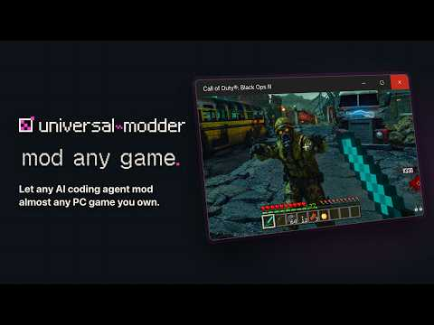</a> | **[AI Is Merging Video Games Now (here's how)](https://youtu.be/9dDJq1LGBAw)** `Video` | Better Stack | 22,543 | 2026-10-12 |
| <a href="https://youtu.be/0Uibt85Jtu0">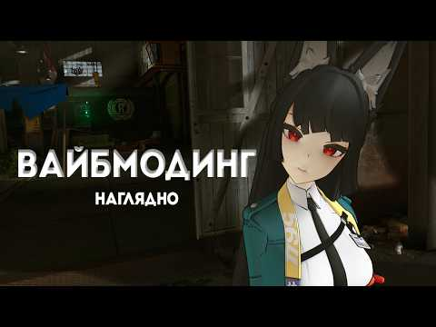</a> | **[Как делать моды без знаний кода \| Гайд по Universal-modder](https://youtu.be/0Uibt85Jtu0)** `Video` | Vilknz 🤿 | 56,306 | 2026-10-09 |
|  | **[AI Merging Games in 2026 EXPLAINED!](https://youtu.be/CVwrRn7COyc)** `Video` | MrToucan Explains Memes | 345,483 | 2026-10-03 |
| <a href="https://youtu.be/jAZ9WQk2UTk">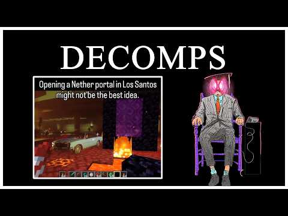</a> | **[Modding Games Is Out Of Control](https://youtu.be/jAZ9WQk2UTk)** `Video` | Lessons in Internet Culture | 444,003 | 2026-10-04 |
| <a href="https://youtu.be/hD-tyU47f84">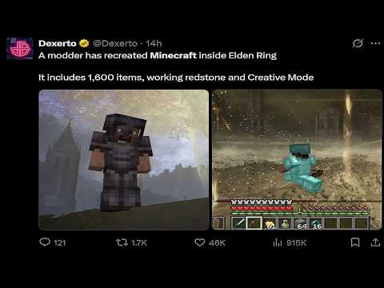</a> | **[Merging Games with AI Situation](https://youtu.be/hD-tyU47f84)** `Video` | Ludocow TV | 199,899 | 2026-09-30 |

#### AI reverse engineering

| | | By | Views | Date |
|---|---|---|---|---|
| <a href="https://rea.tools/guides/native/">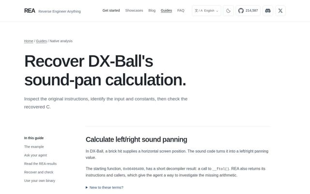</a> | **[rea: native binaries guide](https://rea.tools/guides/native/)** `Guide` How rea drives Ghidra/IDA on native executables from your agent. | rea.tools | | |
| <a href="https://rea.tools/showcase/th04/">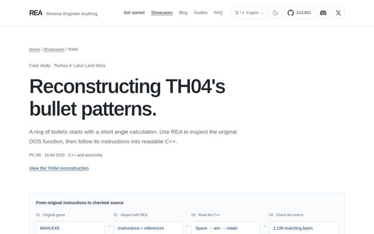</a> | **[rea showcase: TH04 (DOS bullet ring)](https://rea.tools/showcase/th04/)** `Guide` Recovering a DOS-era Touhou bullet-ring calculation step by step. | rea.tools | | |
| <a href="https://rea.tools/showcase/dx-ball/">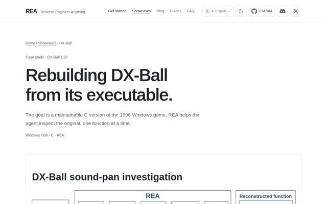</a> | **[rea showcase: DX-Ball sound pan](https://rea.tools/showcase/dx-ball/)** `Guide` Reconstructing DX-Ball's sound-pan calculation from the binary. | rea.tools | | |
|  | **[rea docs: installation + Ghidra DOS / PPC / MIPS / PSP](https://github.com/morluto/rea/blob/HEAD/docs/installation.md)** `Guide` Install guide; console targets: [DOS](https://github.com/morluto/rea/blob/HEAD/docs/ghidra-dos.md) · [PowerPC](https://github.com/morluto/rea/blob/HEAD/docs/ghidra-ppc.md) · [MIPS](https://github.com/morluto/rea/blob/HEAD/docs/ghidra-mips.md) · [PSP](https://github.com/morluto/rea/blob/HEAD/docs/ghidra-psp.md). | morluto/rea | | |
| <a href="https://github.com/rehan-remade/universal-modder/blob/HEAD/skills/reverse-engineering/SKILL.md">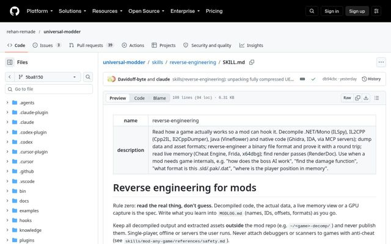</a> | **[skills/reverse-engineering/SKILL.md](https://github.com/rehan-remade/universal-modder/blob/HEAD/skills/reverse-engineering/SKILL.md)** `Guide` universal-modder's agent skill for working out a game's engine and code before modding. | universal-modder | | |
|  | **[ghidraMCP: Now AI Can Reverse Malware](https://youtu.be/u2vQapLAW88)** `Video` | LaurieWired | 188,317 | 2025-03-25 |
| <a href="https://youtu.be/ybSWI2cZzIU">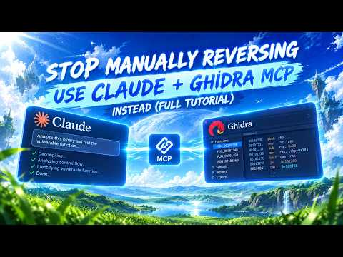</a> | **[Stop Manually Reversing: Use Claude + Ghidra MCP Instead (Full Tutorial)](https://youtu.be/ybSWI2cZzIU)** `Video` | Jackson Mittag | 64,188 | 2026-04-10 |
|  | **[Retro Game Decompilation Using AI by Macabeus](https://youtu.be/sF_Yk0udbZw)** `Video` | Codeminer42 | 10,829 | 2025-12-05 |

#### Classic decomp & recomp

| | | By | Views | Date |
|---|---|---|---|---|
| <a href="https://wiki.decomp.dev/">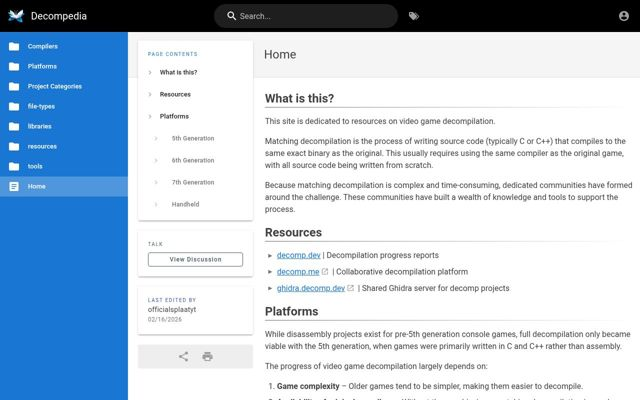</a> | **[decomp.dev wiki](https://wiki.decomp.dev/)** `Guide` Community wiki for matching decompilation: tooling, workflow and how to contribute. | decomp.dev | | |
| <a href="https://github.com/N64Recomp/N64Recomp/wiki">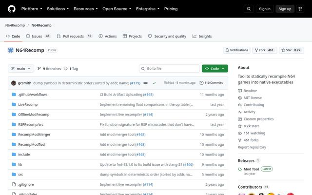</a> | **[N64Recomp wiki](https://github.com/N64Recomp/N64Recomp/wiki)** `Guide` How static recompilation of N64 games works and how to use the tool. | N64Recomp | | |
|  | **[Recompilation: An Incredible New Way to Keep N64 Games Alive](https://youtu.be/ywWwUuWRgsM)** `Video` | Nerrel | 1,104,675 | 2024-05-10 |
| <a href="https://youtu.be/lJVGd7cBGuQ">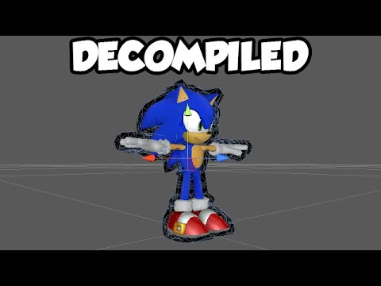</a> | **[I DECOMPILED a Sonic game... here's how](https://youtu.be/lJVGd7cBGuQ)** `Video` | MattKC | 1,013,111 | 2022-10-14 |
| <a href="https://youtu.be/lpOEhtoc3DY">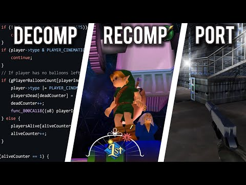</a> | **[N64 : Decomp vs Recomp vs Ports Explained](https://youtu.be/lpOEhtoc3DY)** `Video` | Modern Vintage Gamer | 211,557 | 2025-05-19 |
| <a href="https://youtu.be/45HT9YwhPYo">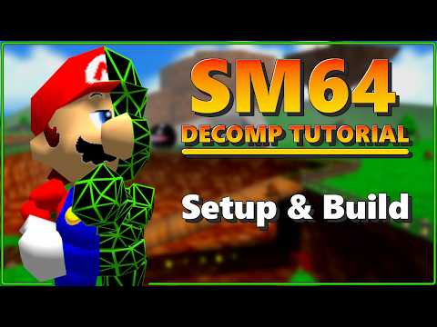</a> | **[Super Mario 64 Decomp Modding Tutorial - Getting Started [Windows 10, 11]](https://youtu.be/45HT9YwhPYo)** `Video` | Rovertronic | 6,798 | 2026-02-14 |

<b>Trend watch</b>

- [Rehan Sheikh (@rehan_shei), 2026-10-12](https://x.com/rehan_shei/status/2109650540158484913): Left fal to start something new; one person with an agent + fal can mash up any game in a weekend, and those mods did 1B+ views in a week.
- [morluto (@morluto), 2026-10-11](https://x.com/morluto/status/2109138696008327226): rea 6.4 is out and much, much faster.

### 1a. AI reverse engineering

MCP servers and agent tools that let a coding agent read, label and explain binaries of games you own.

| | Tool | ⭐ | Last push | What it does | Verified example |
|---|---|---|---|---|---|
| <a href="https://github.com/morluto/rea">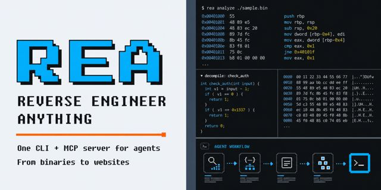</a> | **[morluto/rea](https://github.com/morluto/rea)** | 328.3k | 2026-10-19 | Reverse engineer anything with agents, from app behavior down to native binaries. | [DX-Ball sound-pan reconstruction (README showcase)](https://github.com/morluto/rea#dx-ball-reconstruct-a-sound-pan-calculation) |
|  | **[NationalSecurityAgency/ghidra](https://github.com/NationalSecurityAgency/ghidra)** | 91.2k | 2026-10-16 | Ghidra is a software reverse engineering (SRE) framework |  |
| <a href="https://github.com/radareorg/radare2">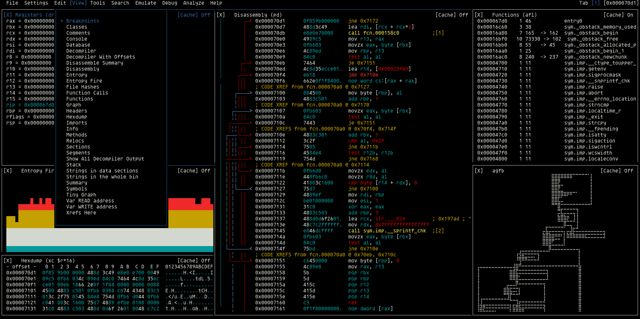</a> | **[radareorg/radare2](https://github.com/radareorg/radare2)** | 25.1k | 2026-10-19 | UNIX-like reverse engineering framework and command-line toolset | [site / demo](https://www.radare.org) |
| <a href="https://github.com/rizinorg/cutter">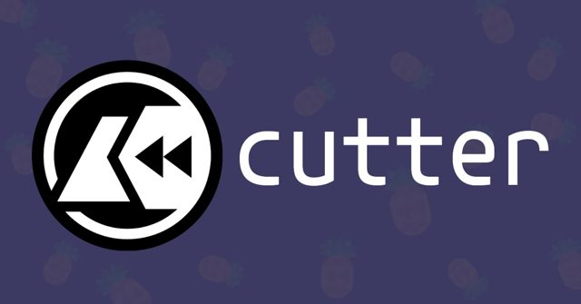</a> | **[rizinorg/cutter](https://github.com/rizinorg/cutter)** | 20.1k | 2026-09-11 | Free and Open Source Reverse Engineering Platform powered by rizin | [site / demo](https://cutter.re) |
| <a href="https://github.com/mrexodia/ida-pro-mcp">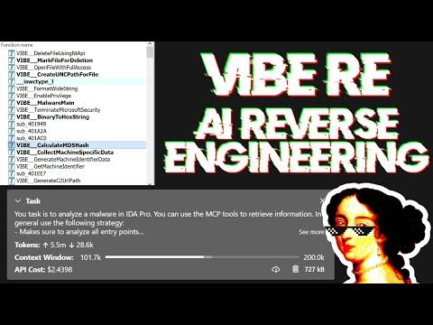</a> | **[mrexodia/ida-pro-mcp](https://github.com/mrexodia/ida-pro-mcp)** | 13.0k | 2026-09-26 | AI-powered reverse engineering assistant that bridges IDA Pro with language models through MCP. | [site / demo](https://plugins.hex-rays.com/mrexodia/ida-pro-mcp) |
| <a href="https://github.com/LaurieWired/GhidraMCP">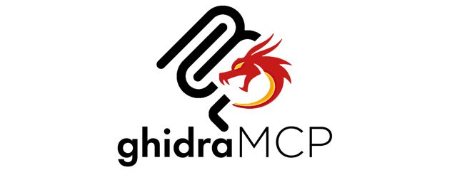</a> | **[LaurieWired/GhidraMCP](https://github.com/LaurieWired/GhidraMCP)** | 11.4k | 2026-10-10 | MCP Server for Ghidra |  |
|  | **[bethington/ghidra-mcp](https://github.com/bethington/ghidra-mcp)** | 5.8k | 2026-10-16 | Ghidra MCP Server — 200+ MCP tools for AI-powered reverse engineering. GUI plugin + headless server, lazy tool loading, convention enforcement, batch operations, Ghidra Server integration, and Docker deployment. |  |
|  | **[clearbluejar/pyghidra-mcp](https://github.com/clearbluejar/pyghidra-mcp)** | 446 | 2026-10-10 | Python Command-Line Ghidra MCP |  |

### 1b. Decomp & recomp projects

Hundreds of decompiled and recompiled games are tracked in our companion list, so they are not duplicated here.

<table><tr>
<td align="center" valign="top" width="33%"><a href="https://github.com/SubmitGame/awesome-decomp-games">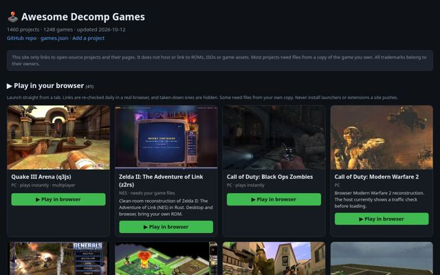</a> <b><a href="https://github.com/SubmitGame/awesome-decomp-games">Awesome Decomp Games</a></b> {f["description"]} <a href="https://submitgame.github.io/awesome-decomp-games/">website</a></td>
</tr></table>

### 1c. Agent-driven modding

Agents that find a game's engine, read its code and build mods for it.

| | Tool | ⭐ | Last push | What it does | Verified example |
|---|---|---|---|---|---|
| <a href="https://github.com/rehan-remade/universal-modder">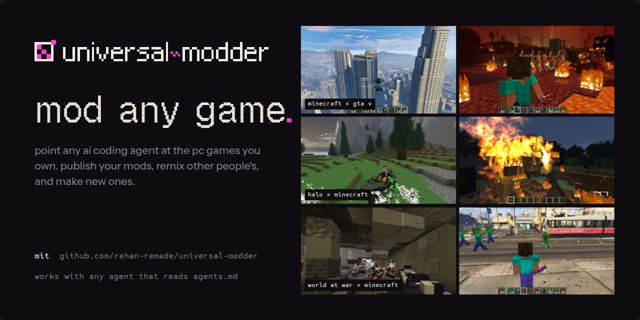</a> | **[rehan-remade/universal-modder](https://github.com/rehan-remade/universal-modder)** | 8.4k | 2026-10-19 | Point Claude at any game. Skills, tools and the fal MCP that let Claude Code mod almost any PC game you own: recon, reverse engineering, fal-generated art/3D/audio, in-game testing, showcase videos. | [Fal Arsenal Terraria mod](https://github.com/rehan-remade/universal-modder/tree/HEAD/examples/terraria-tmodloader) |

### 1d. Mashups & remixes

Mods built by AI agents with universal-modder, plus a curated list of human-made crossovers.

<table><tr>
<td align="center" valign="top" width="33%"><a href="https://github.com/rehan-remade/universal-modder/tree/HEAD/examples/terraria-tmodloader">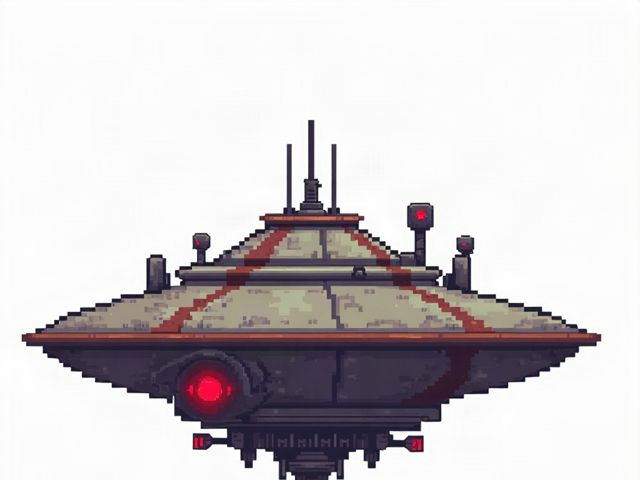</a> <b><a href="https://github.com/rehan-remade/universal-modder/tree/HEAD/examples/terraria-tmodloader">Fal Arsenal (Terraria, tModLoader)</a></b> {f["description"]}</td>
<td align="center" valign="top" width="33%"> <b><a href="https://github.com/rehan-remade/universal-modder/tree/HEAD/examples/aoe2-de-civ">San Franciscans civ (Age of Empires II DE)</a></b> {f["description"]}</td>
<td align="center" valign="top" width="33%"> <b><a href="https://github.com/rehan-remade/universal-modder/tree/HEAD/examples/minecraft-gta5-passthrough">Minecraft inside GTA V</a></b> {f["description"]}</td>
</tr><tr>
<td align="center" valign="top" width="33%"><a href="https://github.com/bailo167/awesome-game-mashups">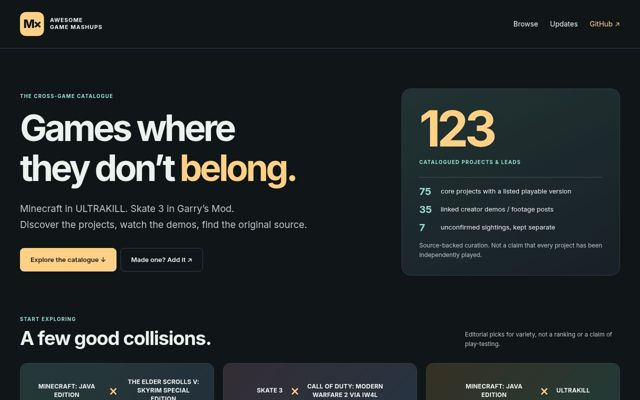</a> <b><a href="https://github.com/bailo167/awesome-game-mashups">bailo167/awesome-game-mashups</a></b> {f["description"]} <a href="https://bailo167.github.io/awesome-game-mashups/">website</a></td>
</tr></table>

| | Tool | ⭐ | Last push | What it does | Verified example |
|---|---|---|---|---|---|
| <a href="https://github.com/bailo167/awesome-game-mashups">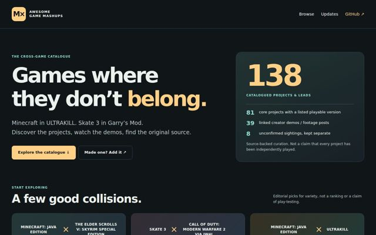</a> | **[bailo167/awesome-game-mashups](https://github.com/bailo167/awesome-game-mashups)** | 111 | 2026-10-19 | Curated list of games rebuilt inside other games — cross-game mechanics, engine/runtime mashups, playable ports, and verified viral projects. | [site / demo](https://bailo167.github.io/awesome-game-mashups/) |

### 1e. AI replacement assets

Upscalers and remaster toolkits for making new textures, models and lighting for games you own.

| | Tool | ⭐ | Last push | What it does | Verified example |
|---|---|---|---|---|---|
| <a href="https://github.com/upscayl/upscayl">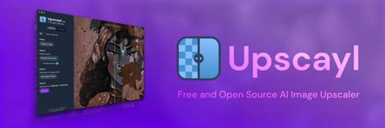</a> | **[upscayl/upscayl](https://github.com/upscayl/upscayl)** | 50.7k | 2026-10-05 | 🆙 Upscayl - #1 Free and Open Source AI Image Upscaler for Linux, MacOS and Windows. | [site / demo](https://upscayl.org) |
|  | **[chaiNNer-org/chaiNNer](https://github.com/chaiNNer-org/chaiNNer)** | 6.1k | 2026-10-17 | A node-based image processing GUI aimed at making chaining image processing tasks easy and customizable. Born as an AI upscaling application, chaiNNer has grown into an extremely flexible and powerful programmatic image processing applicati | [site / demo](https://chaiNNer.app) |
|  | **[NVIDIAGameWorks/rtx-remix](https://github.com/NVIDIAGameWorks/rtx-remix)** | 1.7k | 2026-10-18 | Combined repo for the RTX-Remix runtime and toolkit | [site / demo](https://www.nvidia.com/en-us/geforce/rtx-remix/) |
| <a href="https://github.com/Phhofm/models">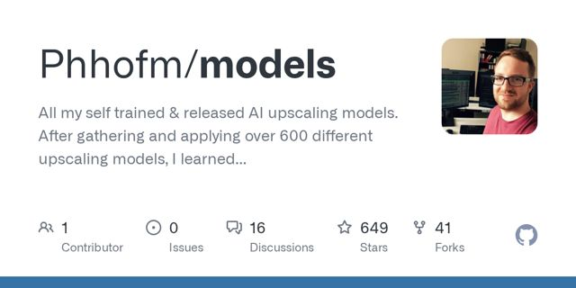</a> | **[Phhofm/models](https://github.com/Phhofm/models)** | 651 | 2025-11-14 | All my self trained & released AI upscaling models. After gathering and applying over 600 different upscaling models, I learned how to train my own models, and these are the results. |  |

## 2. Agents & MCP servers

Coding agents, agent skills, multi-agent game studios and MCP bridges into Unity, Godot, Unreal and Blender.

| | Tool | ⭐ | Last push | What it does | Verified example |
|---|---|---|---|---|---|
| <a href="https://github.com/anomalyco/opencode">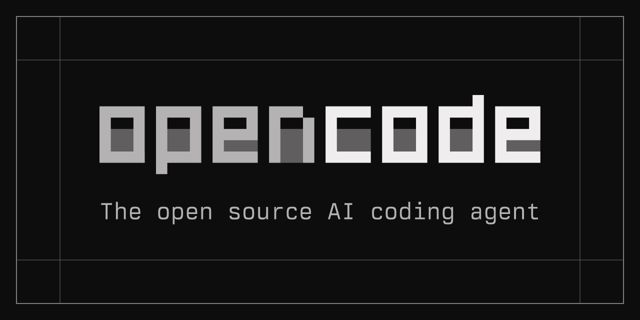</a> | **[anomalyco/opencode](https://github.com/anomalyco/opencode)** | 217.0k | 2026-10-19 | The open source coding agent. | [site / demo](https://opencode.ai) |
| <a href="https://github.com/anthropics/skills">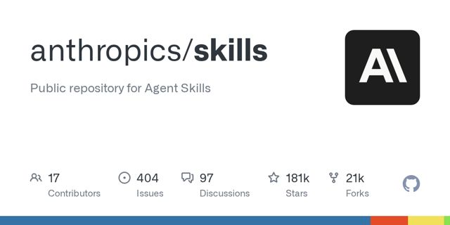</a> | **[anthropics/skills](https://github.com/anthropics/skills)** | 182.1k | 2026-10-09 | Public repository for Agent Skills |  |
| <a href="https://github.com/anthropics/claude-code">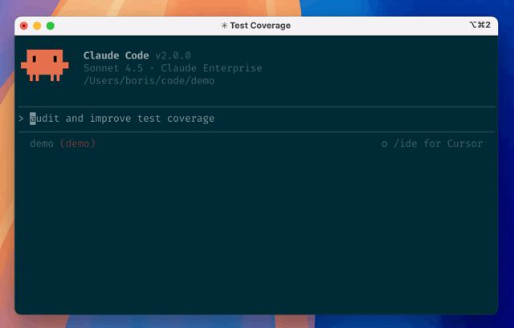</a> | **[anthropics/claude-code](https://github.com/anthropics/claude-code)** | 152.3k | 2026-10-18 | Claude Code is an agentic coding tool that lives in your terminal, understands your codebase, and helps you code faster by executing routine tasks, explaining complex code, and handling git workflows - all through natural language commands. | [site / demo](https://code.claude.com/docs/en/overview) |
| <a href="https://github.com/openai/codex">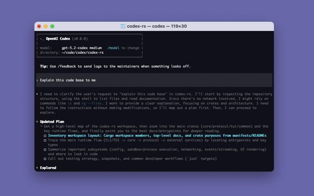</a> | **[openai/codex](https://github.com/openai/codex)** | 129.9k | 2026-10-19 | Lightweight coding agent that runs in your terminal |  |
| <a href="https://github.com/google-gemini/gemini-cli">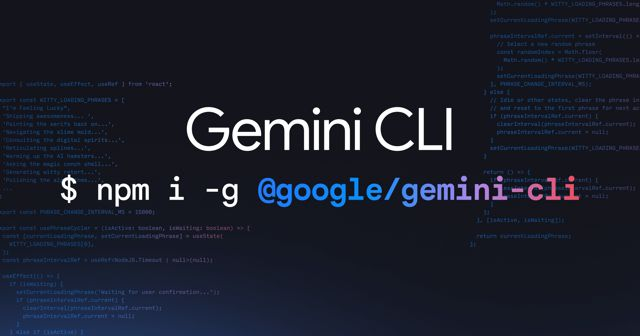</a> | **[google-gemini/gemini-cli](https://github.com/google-gemini/gemini-cli)** | 107.4k | 2026-10-19 | An open-source AI agent that brings the power of Gemini directly into your terminal. | [site / demo](https://geminicli.com) |
| <a href="https://github.com/OpenHands/OpenHands">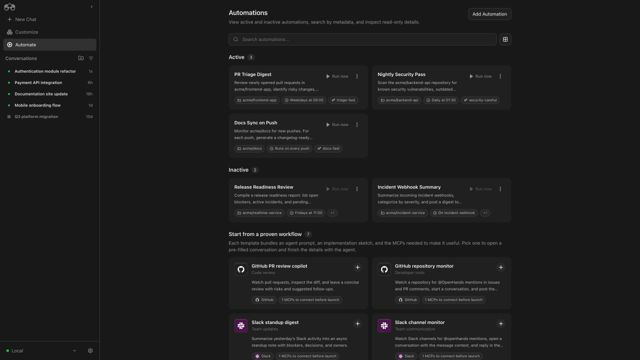</a> | **[OpenHands/OpenHands](https://github.com/OpenHands/OpenHands)** | 91.2k | 2026-10-19 | 🙌 OpenHands: AI-Driven Development | [site / demo](https://openhands.dev) |
| <a href="https://github.com/FoundationAgents/MetaGPT">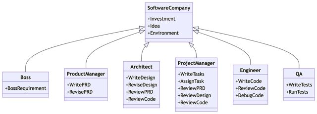</a> | **[FoundationAgents/MetaGPT](https://github.com/FoundationAgents/MetaGPT)** | 70.9k | 2026-01-21 | 🌟 The Multi-Agent Framework: First AI Software Company, Towards Natural Language Programming | [site / demo](https://atoms.dev/) |
| <a href="https://github.com/cline/cline">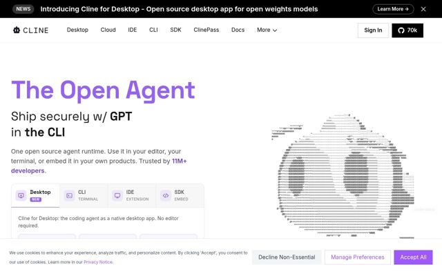</a> | **[cline/cline](https://github.com/cline/cline)** | 70.5k | 2026-10-19 | Autonomous coding agent as an SDK, IDE extension, or CLI assistant. | [site / demo](https://cline.bot) |
| <a href="https://github.com/OpenBMB/ChatDev">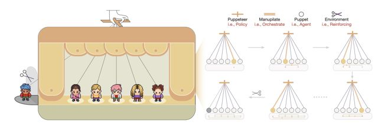</a> | **[OpenBMB/ChatDev](https://github.com/OpenBMB/ChatDev)** | 34.5k | 2026-10-16 | ChatDev 2.0: Dev All through LLM-powered Multi-Agent Collaboration | [site / demo](https://arxiv.org/abs/2307.07924) |
| <a href="https://github.com/ahujasid/mcp-for-blender">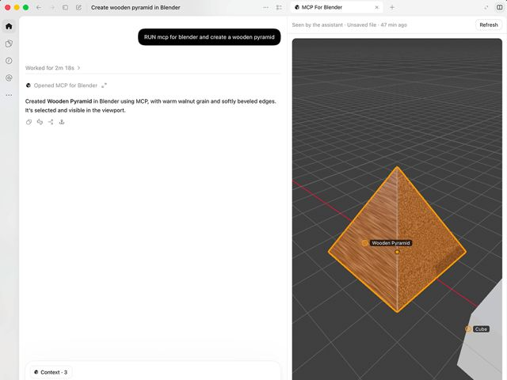</a> | **[ahujasid/mcp-for-blender](https://github.com/ahujasid/mcp-for-blender)** | 31.6k | 2026-10-18 | Community plugin to control Blender 3D with any LLM of your choice. Not affiliated with the official Blender Foundation. | [site / demo](https://www.mcp-for-blender.com/) |
| <a href="https://github.com/QwenLM/Qwen3-Coder">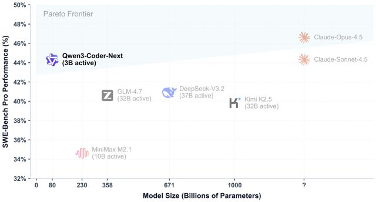</a> | **[QwenLM/Qwen3-Coder](https://github.com/QwenLM/Qwen3-Coder)** | 16.8k | 2026-03-24 | Qwen3-Coder is the code version of Qwen3, the large language model series developed by Qwen team. |  |
| <a href="https://github.com/CoplayDev/unity-mcp">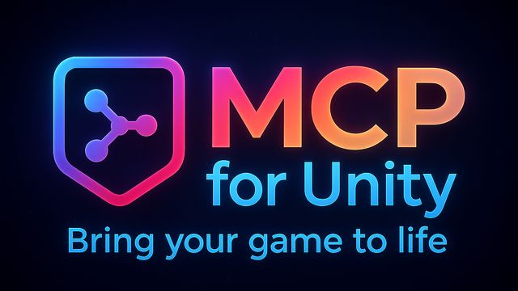</a> | **[CoplayDev/unity-mcp](https://github.com/CoplayDev/unity-mcp)** | 15.1k | 2026-10-19 | Unity MCP acts as a bridge between AI assistants and your Unity Editor. Give your LLM tools to manage assets, control scenes, edit scripts, and automate tasks within Unity. | [site / demo](https://coplaydev.github.io/unity-mcp/) |
| <a href="https://github.com/Coding-Solo/godot-mcp">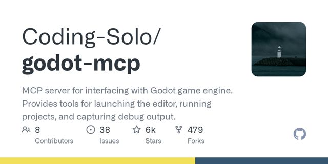</a> | **[Coding-Solo/godot-mcp](https://github.com/Coding-Solo/godot-mcp)** | 6.2k | 2026-04-16 | MCP server for interfacing with Godot game engine. Provides tools for launching the editor, running projects, and capturing debug output. |  |
|  | **[IvanMurzak/Unity-MCP](https://github.com/IvanMurzak/Unity-MCP)** | 4.5k | 2026-10-19 | AI Skills, MCP Tools, and CLI for Unity Engine. Full AI develop and test loop. Use cli for quick setup. Efficient token usage, advanced tools. Any C# method may be turned into a tool by a single line. Works with Claude Code, Gemini, Copilot | [site / demo](https://ai-game.dev) |
| <a href="https://github.com/leigest519/OpenGame">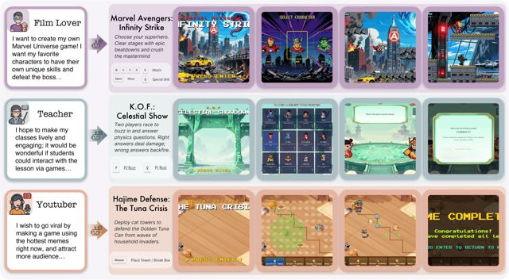</a> | **[leigest519/OpenGame](https://github.com/leigest519/OpenGame)** | 3.0k | 2026-09-03 | OpenGame: Open Agentic Coding for Games |  |
| <a href="https://github.com/CoderGamester/mcp-unity">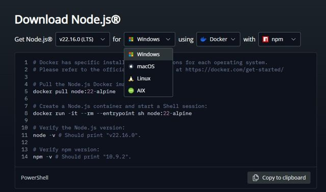</a> | **[CoderGamester/mcp-unity](https://github.com/CoderGamester/mcp-unity)** | 1.9k | 2026-10-11 | Model Context Protocol (MCP) plugin to connect with Unity Editor — designed for Cursor, Claude Code, Codex, Windsurf and other IDEs |  |
| <a href="https://github.com/flopperam/unreal-engine-mcp">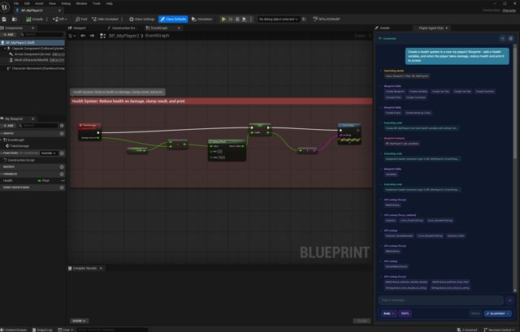</a> | **[flopperam/unreal-engine-mcp](https://github.com/flopperam/unreal-engine-mcp)** | 1.1k | 2026-06-26 | This MCP is now owned by Aura! Please try out the most intelligent AI agent for Unreal Engine at https://www.tryaura.dev/?utm_source=youtube&utm_medium=video&utm_campaign=flop | [site / demo](https://www.tryaura.dev/?utm_source=youtube&utm_medium=video&utm_campaign=flop) |
|  | **[IvanMurzak/Godot-MCP](https://github.com/IvanMurzak/Godot-MCP)** | 295 | 2026-10-19 | Godot-MCP — Model Context Protocol (MCP) integration for the Godot Engine. AI tools for the Godot Editor in C#, with cloud connection to ai-game.dev. Apache-2.0. | [site / demo](https://ai-game.dev) |
|  | **[TREE-Ind/Unreal-Agent](https://github.com/TREE-Ind/Unreal-Agent)** | 238 | 2026-06-18 | A collection of Unreal Engine 5 Editor Utility widgets powered by GPT3/4 |  |

### Hosted tools

Hosted services and models that live outside GitHub. They have no GitHub stars, so the star and activity rules don't apply; a cited signal is shown where one exists.

| | Service | Signal | What it does |
|---|---|---|---|
| <a href="https://www.bezi.com">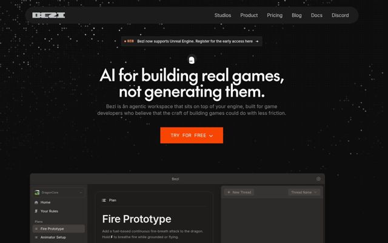</a> | **[Bezi](https://www.bezi.com)** `Hosted` | Hosted | The AI assistant built for Unity developers: debugging, code generation, shader creation and prototyping, working with your actual project. |

## 3. Game generation & world models

Interactive world models, playable video generation and procedural world/level generators.

| | Tool | ⭐ | Last push | What it does | Verified example |
|---|---|---|---|---|---|
|  | **[NVIDIA/cosmos](https://github.com/NVIDIA/cosmos)** | 12.1k | 2026-10-16 | NVIDIA Cosmos is an open platform of world models, datasets, and tools that enables developers to build Physical AI for robots, autonomous vehicles, smart infrastructure, and more. | [site / demo](https://www.nvidia.com/en-us/ai/cosmos/) |
|  | **[princeton-vl/infinigen](https://github.com/princeton-vl/infinigen)** | 7.3k | 2026-10-14 | Infinite Photorealistic Worlds using Procedural Generation | [site / demo](https://infinigen.org) |
|  | **[Tencent-Hunyuan/HunyuanWorld-1.0](https://github.com/Tencent-Hunyuan/HunyuanWorld-1.0)** | 3.0k | 2026-04-15 | Generating Immersive, Explorable, and Interactive 3D Worlds from Words or Pixels with Hunyuan3D World Model | [site / demo](https://3d.hunyuan.tencent.com/sceneTo3D) |
|  | **[NVlabs/LongLive](https://github.com/NVlabs/LongLive)** | 2.8k | 2026-10-19 | Long Video Gen / World Model / World Action Model (Embodied) Infrastructure | [site / demo](https://nvlabs.github.io/LongLive) |
|  | **[SkyworkAI/Matrix-Game](https://github.com/SkyworkAI/Matrix-Game)** | 2.6k | 2026-10-16 | Matrix-Game 4.0: Streaming Neural Rendering for Playable Games | [site / demo](https://matrix-game-v4-0.github.io/page/) |
|  | **[Tencent-Hunyuan/HY-WorldPlay](https://github.com/Tencent-Hunyuan/HY-WorldPlay)** | 1.6k | 2026-06-10 | HY-World 1.5: A Systematic Framework for Interactive World Modeling with Real-Time Latency and Geometric Consistency | [site / demo](https://3d-models.hunyuan.tencent.com/world/) |
|  | **[Tencent-Hunyuan/HunyuanWorld-Voyager](https://github.com/Tencent-Hunyuan/HunyuanWorld-Voyager)** | 1.6k | 2026-04-15 | Voyager is an interactive RGBD video generation model conditioned on camera input, and supports real-time 3D reconstruction. | [site / demo](https://3d-models.hunyuan.tencent.com/world/) |
|  | **[Tencent-Hunyuan/Hunyuan-GameCraft-1.0](https://github.com/Tencent-Hunyuan/Hunyuan-GameCraft-1.0)** | 760 | 2025-11-28 | Hunyuan-GameCraft: High-dynamic Interactive Game Video Generation with Hybrid History Condition | [site / demo](https://hunyuan-gamecraft.github.io/) |
|  | **[hzxie/CityDreamer](https://github.com/hzxie/CityDreamer)** | 701 | 2026-09-07 | The official implementation of "CityDreamer: Compositional Generative Model of Unbounded 3D Cities". (CVPR 2024) | [site / demo](https://haozhexie.com/project/city-dreamer) |
|  | **[genex-games/genex-desktop](https://github.com/genex-games/genex-desktop)** | 640 | 2026-10-19 | Desktop app for game dev with AI. macOS and Linux, Windows soon. | [site / demo](https://genex.games/desktop) |

### Hosted AI game makers

Hosted services and models that live outside GitHub. They have no GitHub stars, so the star and activity rules don't apply; a cited signal is shown where one exists.

| | Service | Signal | What it does |
|---|---|---|---|
|  | **[OrigoZero](https://origozero.ai)** `Hosted` | Hosted | An AI game maker for 3D games in the browser: describe your idea, an agent builds it live in the Zero engine, then publish it on OrigoZero for anyone to play. |
|  | **[mindblown](https://mindblown.ai)** `Hosted` | Hosted | Describe a game and mindblown's AI game maker builds it, playtests it and puts it online. Change it by chatting, or play free browser games others made. |
|  | **[OmGithub](https://omgithub.com)** `Hosted` | Hosted | Discover and play games, and explore their creators and source on GitHub; also lets you make games. |
|  | **[Astrocade](https://astrocade.com)** `Hosted` | [Raised $56M](https://www.astrocade.com/blog/astrocade-raises-56m-funding) · [10M monthly players](https://gamesbeat.com/astrocade-hits-10m-monthly-players-for-its-ai-assisted-ugc-casual-games-platform/) | The social gaming platform where anyone can build, share, and play AI games. No coding or downloads. |
|  | **[Bitmagic](https://bitmagic.ai)** `Hosted` | [$4M seed incl. Supercell](https://bitmagic.ai/about/) | AI-first game development: new games from new creators every day, one tap, in your browser, free. |
|  | **[Rosebud AI](https://rosebud.ai)** `Hosted` | Hosted | Create playable games with AI prompts. Describe your idea or choose a template, then build and deploy your game. No coding required. |
|  | **[Spawn](https://spawn.co)** `Hosted` | Hosted | Your place to make games with friends: describe anything and Savi, your AI game builder, makes it with you. Then play together instantly in your browser. |
|  | **[Upit](https://upit.com)** `Hosted` | Hosted | AI game creator: create, play and share games with Upit. |
|  | **[Jabali](https://www.jabali.ai)** `Hosted` | Hosted | Create your own game instantly with Jabali's AI game generator: puzzle, shooter, anime games and more with no code, playable in minutes. |
|  | **[Makko AI](https://www.makko.ai)** `Hosted` | Hosted | Make 2D games with AI: start with concept art, then create characters, backgrounds, objects and animations in one consistent style, and build playable games in your browser. |

## 4. Code & engines

Engines that agents write well for, plus LLM integrations for engines.

| | Tool | ⭐ | Last push | What it does | Verified example |
|---|---|---|---|---|---|
|  | **[godotengine/godot](https://github.com/godotengine/godot)** | 118.7k | 2026-10-18 | Godot Engine – Multi-platform 2D and 3D game engine | [site / demo](https://godotengine.org) |
|  | **[mrdoob/three.js](https://github.com/mrdoob/three.js)** | 116.6k | 2026-10-19 | JavaScript 3D Library. | [Three.js Quake (playable)](https://mrdoob.github.io/three-quake/) |
|  | **[bevyengine/bevy](https://github.com/bevyengine/bevy)** | 49.1k | 2026-10-19 | A refreshingly simple data-driven game engine built in Rust | [site / demo](https://bevy.org) |
|  | **[phaserjs/phaser](https://github.com/phaserjs/phaser)** | 40.5k | 2026-08-21 | Phaser is a fun, free and fast 2D game framework for making HTML5 games for desktop and mobile web browsers, supporting Canvas and WebGL rendering. |  |
|  | **[raysan5/raylib](https://github.com/raysan5/raylib)** | 35.3k | 2026-10-19 | A simple and easy-to-use library to enjoy videogames programming |  |
|  | **[Genesis-Embodied-AI/genesis-world](https://github.com/Genesis-Embodied-AI/genesis-world)** | 30.1k | 2026-10-17 | Simulation platform for general-purpose robotics & embodied AI learning. | [site / demo](https://genesis-world.readthedocs.io) |
|  | **[4ian/GDevelop](https://github.com/4ian/GDevelop)** | 27.7k | 2026-10-19 | 🎮 Open-source, cross-platform 2D/3D/multiplayer game engine designed for everyone. | [site / demo](https://gdevelop.io) |
|  | **[BabylonJS/Babylon.js](https://github.com/BabylonJS/Babylon.js)** | 26.2k | 2026-10-16 | Babylon.js is a powerful, beautiful, simple, and open game and rendering engine packed into a friendly JavaScript framework. |  |
|  | **[libgdx/libgdx](https://github.com/libgdx/libgdx)** | 25.5k | 2026-10-14 | Desktop/Android/HTML5/iOS Java game development framework |  |
|  | **[playcanvas/engine](https://github.com/playcanvas/engine)** | 17.1k | 2026-10-19 | Powerful web graphics runtime built on WebGL, WebGPU, WebXR and glTF | [site / demo](https://playcanvas.com) |
|  | **[o3de/o3de](https://github.com/o3de/o3de)** | 9.8k | 2026-10-17 | Open 3D Engine (O3DE) is an Apache 2.0-licensed multi-platform 3D engine that enables developers and content creators to build AAA games, cinema-quality 3D worlds, and high-fidelity simulations without any fees or commercial obligations. | [site / demo](https://o3de.org) |
|  | **[defold/defold](https://github.com/defold/defold)** | 6.4k | 2026-10-19 | Defold is a completely free to use game engine for development of desktop, console, mobile and web games. | [site / demo](https://www.defold.com) |
|  | **[undreamai/LLMUnity](https://github.com/undreamai/LLMUnity)** | 1.7k | 2026-04-29 | Create characters in Unity with LLMs! | [site / demo](https://undream.ai) |

## 5. Art

Image, sprite, texture and UI generation and editing.

| | Tool | ⭐ | Last push | What it does | Verified example |
|---|---|---|---|---|---|
|  | **[AUTOMATIC1111/stable-diffusion-webui](https://github.com/AUTOMATIC1111/stable-diffusion-webui)** | 165.1k | 2026-03-02 | Stable Diffusion web UI |  |
|  | **[Comfy-Org/ComfyUI](https://github.com/Comfy-Org/ComfyUI)** | 139.0k | 2026-10-19 | The most powerful and modular diffusion model GUI, api and backend with a graph/nodes interface. The fastest local inference engine in the world. | [site / demo](https://www.comfy.org/) |
|  | **[lllyasviel/Fooocus](https://github.com/lllyasviel/Fooocus)** | 53.6k | 2025-12-01 | Focus on prompting and generating |  |
|  | **[aseprite/aseprite](https://github.com/aseprite/aseprite)** | 40.2k | 2026-10-14 | Animated sprite editor & pixel art tool (Windows, macOS, Linux) | [site / demo](https://www.aseprite.org) |
|  | **[facebookresearch/sam2](https://github.com/facebookresearch/sam2)** | 20.0k | 2026-05-30 | The repository provides code for running inference with the Meta Segment Anything Model 2 (SAM 2), links for downloading the trained model checkpoints, and example notebooks that show how to use the model. |  |
|  | **[Orama-Interactive/Pixelorama](https://github.com/Orama-Interactive/Pixelorama)** | 10.6k | 2026-10-18 | Unleash your creativity with Pixelorama, a powerful and accessible open-source pixel art multitool. Whether you want to create sprites, tiles, animations, or just express yourself in the language of pixel art, this software will realize you | [site / demo](https://www.pixelorama.org/) |
|  | **[DepthAnything/Depth-Anything-V2](https://github.com/DepthAnything/Depth-Anything-V2)** | 9.0k | 2026-03-24 | [NeurIPS 2024] Depth Anything V2. A More Capable Foundation Model for Monocular Depth Estimation | [site / demo](https://depth-anything-v2.github.io) |
|  | **[QwenLM/Qwen-Image](https://github.com/QwenLM/Qwen-Image)** | 8.4k | 2026-02-10 | Qwen-Image is a powerful image generation foundation model capable of complex text rendering and precise image editing. |  |
|  | **[carson-katri/dream-textures](https://github.com/carson-katri/dream-textures)** | 8.2k | 2026-09-17 | Stable Diffusion built-in to Blender |  |
|  | **[nadermx/backgroundremover](https://github.com/nadermx/backgroundremover)** | 8.1k | 2026-07-10 | Background Remover lets you Remove Background from images and video using AI with a simple command line interface that is free and open source. | [site / demo](https://backgroundremoverai.com) |
|  | **[Sygil-Dev/sygil-webui](https://github.com/Sygil-Dev/sygil-webui)** | 7.9k | 2026-07-17 | Stable Diffusion web UI |  |
|  | **[leejet/stable-diffusion.cpp](https://github.com/leejet/stable-diffusion.cpp)** | 7.7k | 2026-10-18 | Diffusion model(SD,Flux,Wan,Qwen Image,Z-Image,...) inference in pure C/C++ |  |
|  | **[ByteDance-Seed/Bagel](https://github.com/ByteDance-Seed/Bagel)** | 6.2k | 2026-05-04 | Open-source unified multimodal model |  |
|  | **[VectorSpaceLab/OmniGen](https://github.com/VectorSpaceLab/OmniGen)** | 4.3k | 2025-12-04 | OmniGen: Unified Image Generation. https://arxiv.org/pdf/2409.11340 |  |
|  | **[Tencent-Hunyuan/HunyuanDiT](https://github.com/Tencent-Hunyuan/HunyuanDiT)** | 4.3k | 2026-10-08 | Hunyuan-DiT : A Powerful Multi-Resolution Diffusion Transformer with Fine-Grained Chinese Understanding | [site / demo](https://dit.hunyuan.tencent.com/) |
|  | **[VectorSpaceLab/OmniGen2](https://github.com/VectorSpaceLab/OmniGen2)** | 4.1k | 2026-03-20 | OmniGen2: Exploration to Advanced Multimodal Generation. https://arxiv.org/abs/2506.18871 |  |
|  | **[Tencent-Hunyuan/HunyuanImage-3.0](https://github.com/Tencent-Hunyuan/HunyuanImage-3.0)** | 3.3k | 2026-06-23 | HunyuanImage-3.0: A Powerful Native Multimodal Model for Image Generation | [site / demo](https://hunyuan.tencent.com/image) |
|  | **[Hugo-Dz/spritefusion-pixel-snapper](https://github.com/Hugo-Dz/spritefusion-pixel-snapper)** | 3.3k | 2026-07-16 | A tool to snap pixels to a perfect grid. Designed to fix messy and inconsistent pixel art generated by AI. | [site / demo](https://www.spritefusion.com/pixel-snapper) |
|  | **[SkyworkAI/UniPic](https://github.com/SkyworkAI/UniPic)** | 877 | 2026-07-13 | Open-source SOTA multi-image editing model | [site / demo](https://unipic-v2.github.io/) |

### Hosted tools

Hosted services and models that live outside GitHub. They have no GitHub stars, so the star and activity rules don't apply; a cited signal is shown where one exists.

| | Service | Signal | What it does |
|---|---|---|---|
|  | **[Ludo.ai](https://ludo.ai)** `Hosted` | Hosted | Production-ready game assets (sprites, icons, UI, textures, music, 3D and video) generated by AI, ready to drop into your engine. |
|  | **[Scenario](https://www.scenario.com)** `Hosted` | Hosted | The leading AI models in one place for creative production and game assets. Build image, video, 3D and audio pipelines with workflows and agents. |
|  | **[Layer](https://www.layer.ai)** `Hosted` | Hosted | Generate images, video, 3D and audio with 300+ models, train Layer on your style, and automate production. |
|  | **[God Mode AI](https://www.godmodeai.co)** `Hosted` | Hosted | AI sprite & animation generator for games: artifact-free looping animations, rich action types, multiple camera views and advanced VFX. Commercial licensing included. |
|  | **[FLUX 3 Image Klein](https://huggingface.co/black-forest-labs/flux-3-image-klein)** `Open weights` | [501 likes on Hugging Face](https://huggingface.co/black-forest-labs/flux-3-image-klein) | 5.6B open weights model for text-to-image generation and image editing: a prompt plus up to 10 reference images in, one image out. FLUX Kommunity License (non-commercial, with a commercial-output exception for qualifying users). License: `flux-kommunity-license`. |
|  | **[Krea 3 Image Edit](https://www.krea.ai/krea-3)** `Hosted` | Hosted | Krea 3 is an image editing model built for production: it changes only what you ask, with up to 6 reference images and 1K or 2K output. Available in Krea's app and API; no downloadable weights published. Source: [Civitai announcement](https://civitai.com/articles/36718/krea-3-is-now-on-civitai). |

## 6. 3D, animation & shaders

Image/text-to-3D, motion generation, video and shader tools.

| | Tool | ⭐ | Last push | What it does | Verified example |
|---|---|---|---|---|---|
|  | **[hpcaitech/Open-Sora](https://github.com/hpcaitech/Open-Sora)** | 29.9k | 2026-04-09 | Open-Sora: Democratizing Efficient Video Production for All | [site / demo](https://hpcaitech.github.io/Open-Sora/) |
|  | **[Stability-AI/generative-models](https://github.com/Stability-AI/generative-models)** | 27.3k | 2025-12-16 | Generative Models by Stability AI |  |
|  | **[blender/blender](https://github.com/blender/blender)** | 21.0k | 2026-10-19 | Official mirror of Blender | [site / demo](https://developer.blender.org/docs/handbook/contributing/using_git/#github-mirror) |
|  | **[KlingAIResearch/LivePortrait](https://github.com/KlingAIResearch/LivePortrait)** | 19.3k | 2026-06-01 | Bring portraits to life! | [site / demo](https://liveportrait.github.io) |
|  | **[Wan-Video/Wan2.2](https://github.com/Wan-Video/Wan2.2)** | 18.0k | 2026-09-21 | Wan: Open and Advanced Large-Scale Video Generative Models | [site / demo](https://wan.video) |
|  | **[NVlabs/instant-ngp](https://github.com/NVlabs/instant-ngp)** | 17.6k | 2026-02-02 | Instant neural graphics primitives: lightning fast NeRF and more | [site / demo](https://nvlabs.github.io/instant-ngp) |
|  | **[Wan-Video/Wan2.1](https://github.com/Wan-Video/Wan2.1)** | 17.2k | 2026-03-05 | Wan: Open and Advanced Large-Scale Video Generative Models | [site / demo](https://wan.video) |
|  | **[Tencent-Hunyuan/Hunyuan3D-2](https://github.com/Tencent-Hunyuan/Hunyuan3D-2)** | 15.2k | 2025-10-28 | High-Resolution 3D Assets Generation with Large Scale Hunyuan3D Diffusion Models. | [site / demo](https://3d.hunyuan.tencent.com/) |
|  | **[microsoft/TRELLIS](https://github.com/microsoft/TRELLIS)** | 14.0k | 2026-06-26 | Official repo for paper "Structured 3D Latents for Scalable and Versatile 3D Generation" (CVPR'25 Spotlight). | [site / demo](https://trellis3d.github.io) |
|  | **[modelscope/DiffSynth-Studio](https://github.com/modelscope/DiffSynth-Studio)** | 13.3k | 2026-10-19 | Enjoy the magic of Diffusion models! |  |
|  | **[zai-org/CogVideo](https://github.com/zai-org/CogVideo)** | 13.1k | 2025-11-04 | text and image to video generation: CogVideoX (2024) and CogVideo (ICLR 2023) |  |
|  | **[Tencent-Hunyuan/HunyuanVideo](https://github.com/Tencent-Hunyuan/HunyuanVideo)** | 12.6k | 2026-10-08 | HunyuanVideo: A Systematic Framework For Large Video Generation Model | [site / demo](https://aivideo.hunyuan.tencent.com) |
|  | **[Lightricks/LTX-Video](https://github.com/Lightricks/LTX-Video)** | 11.1k | 2026-01-05 | Official repository for LTX-Video | [site / demo](https://ltx.io/model) |
|  | **[VAST-AI-Research/TripoSR](https://github.com/VAST-AI-Research/TripoSR)** | 7.1k | 2026-06-04 | TripoSR: Fast 3D Object Reconstruction from a Single Image |  |
|  | **[JannisX11/blockbench](https://github.com/JannisX11/blockbench)** | 6.1k | 2026-10-18 | Blockbench - A low poly 3D model editor | [site / demo](https://www.blockbench.net) |
|  | **[Tencent-Hunyuan/HunyuanVideo-1.5](https://github.com/Tencent-Hunyuan/HunyuanVideo-1.5)** | 4.6k | 2026-04-10 | HunyuanVideo-1.5: A leading lightweight video generation model | [site / demo](https://hunyuan.tencent.com/video/zh?tabIndex=0) |
|  | **[nv-tlabs/kimodo](https://github.com/nv-tlabs/kimodo)** | 3.8k | 2026-10-15 | Official implementation of Kimodo, a kinematic motion diffusion model for high-quality human(oid) motion generation. |  |
|  | **[genmoai/mochi](https://github.com/genmoai/mochi)** | 3.7k | 2026-10-06 | The best OSS video generation models, created by Genmo |  |
|  | **[Tencent-Hunyuan/Hunyuan3D-1](https://github.com/Tencent-Hunyuan/Hunyuan3D-1)** | 3.5k | 2025-11-19 | Tencent Hunyuan3D-1.0: A Unified Framework for Text-to-3D and Image-to-3D Generation | [site / demo](https://3d.hunyuan.tencent.com/) |
|  | **[Tencent-Hunyuan/HY-Motion-1.0](https://github.com/Tencent-Hunyuan/HY-Motion-1.0)** | 2.6k | 2026-07-18 | HY-Motion model for 3D human motion or 3D character animation generation. | [site / demo](https://hunyuan.tencent.com/motion) |
|  | **[academa-labs/manimgx](https://github.com/academa-labs/manimgx)** | 1.8k | 2026-10-15 | The animation engine for agents: blazingly fast math and 3D videos with Manim's Python API, on a Rust GPU core.  *Note: An animation/video engine more than a game tool: useful for trailers, explainers and cutscene-style renders.* | [site / demo](https://manimgx.academa.ai) |
|  | **[LordLiang/DrawingSpinUp](https://github.com/LordLiang/DrawingSpinUp)** | 658 | 2026-09-25 | (SIGGRAPH Asia 2024) This is the official PyTorch implementation of SIGGRAPH Asia 2024 paper: DrawingSpinUp: 3D Animation from Single Character Drawings | [site / demo](https://lordliang.github.io/DrawingSpinUp/) |
|  | **[ActiveVisionLab/gaussctrl](https://github.com/ActiveVisionLab/gaussctrl)** | 135 | 2026-03-19 | [ECCV 2024] GaussCtrl: Multi-View Consistent Text-Driven 3D Gaussian Splatting Editing | [site / demo](https://gaussctrl.active.vision/) |

### Hosted tools

Hosted services and models that live outside GitHub. They have no GitHub stars, so the star and activity rules don't apply; a cited signal is shown where one exists.

| | Service | Signal | What it does |
|---|---|---|---|
|  | **[Meshy](https://www.meshy.ai)** `Hosted` | Hosted | Turns text and images into production-ready 3D models in 20-30 seconds. Export to FBX, OBJ, GLB and STL. |

## 7. Audio

Sound effects, music and voice.

| | Tool | ⭐ | Last push | What it does | Verified example |
|---|---|---|---|---|---|
|  | **[openai/whisper](https://github.com/openai/whisper)** | 110.8k | 2026-08-31 | Robust Speech Recognition via Large-Scale Weak Supervision |  |
|  | **[RVC-Boss/GPT-SoVITS](https://github.com/RVC-Boss/GPT-SoVITS)** | 63.2k | 2026-10-18 | 1 min voice data can also be used to train a good TTS model! (few shot voice cloning) |  |
|  | **[microsoft/VibeVoice](https://github.com/microsoft/VibeVoice)** | 54.9k | 2026-10-08 | Open-Source Frontier Voice AI | [site / demo](https://microsoft.github.io/VibeVoice/) |
|  | **[2noise/ChatTTS](https://github.com/2noise/ChatTTS)** | 39.9k | 2026-04-10 | A generative speech model for daily dialogue. | [site / demo](https://2noise.com) |
|  | **[OpenBMB/VoxCPM](https://github.com/OpenBMB/VoxCPM)** | 39.6k | 2026-10-08 | VoxCPM2: Tokenizer-Free TTS for Multilingual Speech Generation, Creative Voice Design, and True-to-Life Cloning | [site / demo](https://voxcpm.com) |
|  | **[RVC-Project/Retrieval-based-Voice-Conversion-WebUI](https://github.com/RVC-Project/Retrieval-based-Voice-Conversion-WebUI)** | 38.8k | 2026-08-04 | Easily train a good VC model with voice data <= 10 mins! |  |
|  | **[resemble-ai/chatterbox](https://github.com/resemble-ai/chatterbox)** | 27.1k | 2026-07-21 | SoTA open-source TTS | [site / demo](https://resemble-ai.github.io/chatterbox_demopage/) |
|  | **[index-tts/index-tts](https://github.com/index-tts/index-tts)** | 24.6k | 2026-09-29 | An Industrial-Level Controllable and Efficient Zero-Shot Text-To-Speech System |  |
|  | **[QwenAudio/CosyVoice](https://github.com/QwenAudio/CosyVoice)** | 24.0k | 2026-05-25 | Multi-lingual large voice generation model, providing inference, training and deployment full-stack ability. |  |
|  | **[facebookresearch/audiocraft](https://github.com/facebookresearch/audiocraft)** | 23.7k | 2026-03-03 | Audiocraft is a library for audio processing and generation with deep learning. It features the state-of-the-art EnCodec audio compressor / tokenizer, along with MusicGen, a simple and controllable music generation LM with textual and melod |  |
|  | **[KittenML/KittenTTS](https://github.com/KittenML/KittenTTS)** | 16.2k | 2026-10-16 | Open-source State-of-the-art TTS model which runs on a CPU 😻 |  |
|  | **[QwenLM/Qwen3-TTS](https://github.com/QwenLM/Qwen3-TTS)** | 13.9k | 2026-03-17 | Qwen3-TTS is an open-source series of TTS models developed by the Qwen team at Alibaba Cloud, supporting stable, expressive, and streaming speech generation, free-form voice design, and vivid voice cloning. |  |
|  | **[multimodal-art-projection/YuE](https://github.com/multimodal-art-projection/YuE)** | 12.3k | 2026-10-06 | YuE2: frontier music generation with symbolic planning, zero-shot covers, and agentic music editing. | [site / demo](https://map-yue2.github.io/) |
|  | **[open-mmlab/Amphion](https://github.com/open-mmlab/Amphion)** | 10.3k | 2026-03-25 | Amphion (/æmˈfaɪən/) is a toolkit for Audio, Music, and Speech Generation. Its purpose is to support reproducible research and help junior researchers and engineers get started in the field of audio, music, and speech generation research an |  |
|  | **[fishaudio/Bert-VITS2](https://github.com/fishaudio/Bert-VITS2)** | 8.8k | 2026-10-12 | vits2 backbone with multilingual-bert |  |
|  | **[jasonppy/VoiceCraft](https://github.com/jasonppy/VoiceCraft)** | 8.6k | 2026-05-30 | Zero-Shot Speech Editing and Text-to-Speech in the Wild |  |
|  | **[netease-youdao/EmotiVoice](https://github.com/netease-youdao/EmotiVoice)** | 8.5k | 2026-09-03 | EmotiVoice 😊: a Multi-Voice and Prompt-Controlled TTS Engine |  |
|  | **[boson-ai/higgs-audio](https://github.com/boson-ai/higgs-audio)** | 8.4k | 2026-06-05 | Text-audio foundation model from Boson AI |  |
|  | **[ace-step/ACE-Step](https://github.com/ace-step/ACE-Step)** | 5.0k | 2026-02-15 | ACE-Step: A Step Towards Music Generation Foundation Model | [site / demo](https://ace-step.github.io/) |
|  | **[MoonInTheRiver/DiffSinger](https://github.com/MoonInTheRiver/DiffSinger)** | 4.9k | 2026-07-24 | DiffSinger: Singing Voice Synthesis via Shallow Diffusion Mechanism (SVS & TTS); AAAI 2022; Official code |  |
|  | **[WhisperSpeech/WhisperSpeech](https://github.com/WhisperSpeech/WhisperSpeech)** | 4.7k | 2025-12-14 | An Open Source text-to-speech system built by inverting Whisper. | [site / demo](https://whisperspeech.github.io/WhisperSpeech/) |
|  | **[KoljaB/RealtimeTTS](https://github.com/KoljaB/RealtimeTTS)** | 4.0k | 2026-10-18 | Converts text to speech in realtime |  |
|  | **[IAHispano/Applio](https://github.com/IAHispano/Applio)** | 3.9k | 2026-10-19 | A simple, high-quality voice conversion tool focused on ease of use and performance. | [site / demo](https://applio.org) |
|  | **[rsxdalv/TTS-WebUI](https://github.com/rsxdalv/TTS-WebUI)** | 3.3k | 2026-09-07 | A single Gradio + React WebUI with extensions for ACE-Step, OmniVoice, Kimi Audio, Piper TTS, GPT-SoVITS, CosyVoice, XTTSv2, DIA, Kokoro, OpenVoice, ParlerTTS, Stable Audio, MMS, StyleTTS2, MAGNet, AudioGen, MusicGen, Tortoise, RVC, Vocos, |  |
|  | **[hkchengrex/MMAudio](https://github.com/hkchengrex/MMAudio)** | 2.3k | 2026-02-23 | [CVPR 2025] MMAudio: Taming Multimodal Joint Training for High-Quality Video-to-Audio Synthesis | [site / demo](https://hkchengrex.com/MMAudio/) |
|  | **[ZeyueT/AudioX](https://github.com/ZeyueT/AudioX)** | 1.6k | 2026-03-10 | [ICLR 2026] Repository of AudioX | [site / demo](https://zeyuet.github.io/AudioX/) |
|  | **[FireRedTeam/FireRedTTS2](https://github.com/FireRedTeam/FireRedTTS2)** | 1.4k | 2025-10-26 | Long-form streaming TTS system for multi-speaker dialogue generation |  |
|  | **[QwenAudio/ThinkSound](https://github.com/QwenAudio/ThinkSound)** | 1.4k | 2026-04-03 | [NeurIPS 2025] PyTorch implementation of [ThinkSound], a unified framework for generating audio from any modality, guided by Chain-of-Thought (CoT) reasoning. | [site / demo](https://thinksound-project.github.io/) |
|  | **[shivammehta25/Matcha-TTS](https://github.com/shivammehta25/Matcha-TTS)** | 1.4k | 2026-10-12 | [ICASSP 2024] 🍵 Matcha-TTS: A fast TTS architecture with conditional flow matching | [site / demo](https://shivammehta25.github.io/Matcha-TTS/) |
|  | **[open-mmlab/FoleyCrafter](https://github.com/open-mmlab/FoleyCrafter)** | 665 | 2026-06-15 | [IJCV 2026] FoleyCrafter: Bring Silent Videos to Life with Lifelike and Synchronized Sounds. AI拟音大师，给你的无声视频添加生动而且同步的音效  😝 | [site / demo](https://foleycrafter.github.io/) |

## 8. NPCs & narrative

LLM characters, generative agents, talking avatars and story tools.

| | Tool | ⭐ | Last push | What it does | Verified example |
|---|---|---|---|---|---|
|  | **[oobabooga/textgen](https://github.com/oobabooga/textgen)** | 47.7k | 2026-08-17 | Open-source desktop app for local LLMs. Text, vision, tool-calling, OpenAI/Anthropic-compatible API. 100% private. |  |
|  | **[janhq/jan](https://github.com/janhq/jan)** | 45.0k | 2026-10-19 | Jan is an open source alternative to ChatGPT that runs 100% offline on your computer. | [site / demo](https://jan.ai/) |
|  | **[pipecat-ai/pipecat](https://github.com/pipecat-ai/pipecat)** | 16.6k | 2026-10-19 | Open Source framework for voice agents, multimodal apps, and realtime AI. Maintained by Daily and the community. | [site / demo](https://pipecat.ai) |
|  | **[kyutai-labs/moshi](https://github.com/kyutai-labs/moshi)** | 11.3k | 2026-09-09 | Moshi is a speech-text foundation model and full-duplex spoken dialogue framework. It uses Mimi, a state-of-the-art streaming neural audio codec. |  |
|  | **[TEN-framework/ten-framework](https://github.com/TEN-framework/ten-framework)** | 11.2k | 2026-10-19 | Open-source framework for conversational voice AI agents | [site / demo](https://agent.theten.ai/) |
|  | **[a16z-infra/ai-town](https://github.com/a16z-infra/ai-town)** | 10.7k | 2026-08-26 | A MIT-licensed, deployable starter kit for building and customizing your own version of AI town - a virtual town where AI characters live, chat and socialize. | [site / demo](https://convex.dev/ai-town) |
|  | **[duixcom/Duix-Mobile](https://github.com/duixcom/Duix-Mobile)** | 8.3k | 2026-08-05 | 🚀 The best real-time interactive AI avatar(digital human) with on-premise deployment and <1.5 s latency. | [site / demo](https://www.duix.com) |
|  | **[MeiGen-AI/InfiniteTalk](https://github.com/MeiGen-AI/InfiniteTalk)** | 8.1k | 2026-05-22 | ​​Unlimited-length talking video generation​​ that supports image-to-video and video-to-video generation |  |
|  | **[Kedreamix/Linly-Talker](https://github.com/Kedreamix/Linly-Talker)** | 3.5k | 2026-02-10 | Digital Avatar Conversational System - Linly-Talker. 😄✨ Linly-Talker is an intelligent AI system that combines large language models (LLMs) with visual models to create a novel human-AI interaction method. 🤝🤖 It integrates various technolog | [site / demo](https://kedreamix.github.io/) |
|  | **[uezo/ChatdollKit](https://github.com/uezo/ChatdollKit)** | 1.2k | 2026-09-10 | ChatdollKit enables you to make your 3D model into a chatbot |  |
|  | **[antgroup/ditto-talkinghead](https://github.com/antgroup/ditto-talkinghead)** | 908 | 2025-11-12 | [ACM MM 2025] Ditto: Motion-Space Diffusion for Controllable Realtime Talking Head Synthesis | [site / demo](https://digital-avatar.github.io/ai/Ditto/) |
|  | **[AkshitIreddy/Interactive-LLM-Powered-NPCs](https://github.com/AkshitIreddy/Interactive-LLM-Powered-NPCs)** | 732 | 2026-10-16 | Interactive LLM Powered NPCs, is an open-source project that completely transforms your interaction with non-player characters (NPCs) in any game! 🎮🤖🚀 | [site / demo](https://www.linkedin.com/company/alystria-ai) |
|  | **[indentlabs/notebook](https://github.com/indentlabs/notebook)** | 411 | 2026-10-17 | Notebook.ai is a set of tools for writers, game designers, and roleplayers to create magnificent universes – and everything within them. |  |
|  | **[YanqiDai/MMRole](https://github.com/YanqiDai/MMRole)** | 102 | 2026-02-02 | [ICLR 2025] A Comprehensive Framework for Developing and Evaluating Multimodal Role-Playing Agents |  |

## 9. Testing, QA & analytics

Game-playing agents, RL environments and automated testing.

| | Tool | ⭐ | Last push | What it does | Verified example |
|---|---|---|---|---|---|
|  | **[microsoft/playwright](https://github.com/microsoft/playwright)** | 98.0k | 2026-10-18 | Playwright is a framework for Web Testing and Automation. It allows testing Chromium, Firefox and WebKit with a single API. | [site / demo](https://playwright.dev) |
|  | **[Unity-Technologies/ml-agents](https://github.com/Unity-Technologies/ml-agents)** | 19.8k | 2026-10-13 | The Unity Machine Learning Agents Toolkit (ML-Agents) is an open-source project that enables games and simulations to serve as environments for training intelligent agents using deep reinforcement learning and imitation learning. | [site / demo](https://unity.com/products/machine-learning-agents) |
|  | **[Farama-Foundation/Gymnasium](https://github.com/Farama-Foundation/Gymnasium)** | 12.7k | 2026-10-14 | A standard API for single-agent reinforcement learning environments, with popular reference environments and related utilities (formerly Gym) | [site / demo](https://gymnasium.farama.org) |
|  | **[THUDM/AgentBench](https://github.com/THUDM/AgentBench)** | 3.8k | 2026-02-08 | A Comprehensive Benchmark to Evaluate LLMs as Agents (ICLR'24) |  |
|  | **[Farama-Foundation/Arcade-Learning-Environment](https://github.com/Farama-Foundation/Arcade-Learning-Environment)** | 2.5k | 2026-10-17 | A simple framework that allows researchers and hobbyists to develop AI agents for Atari 2600 games | [site / demo](https://ale.farama.org/) |

## 10. Showcase

Playable games made or remade with AI, with source code.

| | Tool | ⭐ | Last push | What it does | Verified example |
|---|---|---|---|---|---|
|  | **[mshumer/Claude-of-Duty](https://github.com/mshumer/Claude-of-Duty)** | 3.5k | 2026-07-25 | A Call of Duty-quality FPS in Three.js, built from a single prompt. |  |
|  | **[ill-inc/biomes-game](https://github.com/ill-inc/biomes-game)** | 2.7k | 2026-05-16 | Biomes is an open source sandbox MMORPG built for the web using web technologies such as Next.js, Typescript, React and WebAssembly. | [site / demo](https://www.biomes.gg) |
|  | **[mrdoob/three-quake](https://github.com/mrdoob/three-quake)** | 338 | 2026-08-14 | A port of Quake to Three.js. | [Play in browser](https://mrdoob.github.io/three-quake/) |

More playable AI-made games without public source live in [aviaryan/awesome-ai-games](https://github.com/aviaryan/awesome-ai-games) and [AgentsLoop/awesome-opus-5.5-games](https://github.com/AgentsLoop/awesome-opus-5.5-games).

## 11. Inactive / unmaintained

61 tools that are archived (🗄️) or have had no push since 2024-10-18 (2 years). They may still work, but don't expect fixes.

<b>AI replacement assets</b> (1)

| | Tool | ⭐ | Last push | What it does | Verified example |
|---|---|---|---|---|---|
|  | **[xinntao/Real-ESRGAN](https://github.com/xinntao/Real-ESRGAN)** | 37.1k | 2024-08-06 | Real-ESRGAN aims at developing Practical Algorithms for General Image/Video Restoration. |  |

<b>Agents & MCP servers</b> (4)

| | Tool | ⭐ | Last push | What it does | Verified example |
|---|---|---|---|---|---|
|  | **[voideditor/void](https://github.com/voideditor/void)** 🗄️ | 28.7k | 2026-06-02 |  | [site / demo](https://voideditor.com) |
|  | **[gd3kr/BlenderGPT](https://github.com/gd3kr/BlenderGPT)** | 5.0k | 2024-06-05 | Use commands in English to control Blender with OpenAI's GPT-4 |  |
|  | **[keijiro/AICommand](https://github.com/keijiro/AICommand)** | 4.1k | 2023-12-05 | ChatGPT integration with Unity Editor |  |
|  | **[TREE-Ind/Blender-GPT](https://github.com/TREE-Ind/Blender-GPT)** | 127 | 2024-09-09 | An all-in-one Blender assistant powered by GPT3/4 + Whisper integration |  |

<b>Game generation & world models</b> (3)

| | Tool | ⭐ | Last push | What it does | Verified example |
|---|---|---|---|---|---|
|  | **[video2game/video2game](https://github.com/video2game/video2game)** | 337 | 2024-04-25 | Code release of Video2Game |  |
|  | **[Keytoyze/Mug-Diffusion](https://github.com/Keytoyze/Mug-Diffusion)** | 318 | 2023-11-23 | High-quality and controllable charting AI for rhythm games, modifed from stable diffusion |  |
|  | **[charmed-ai/tilemapgen](https://github.com/charmed-ai/tilemapgen)** | 106 | 2023-07-01 | A tool for generating isometric dungeon tiles using stable diffusion |  |

<b>Code & engines</b> (5)

| | Tool | ⭐ | Last push | What it does | Verified example |
|---|---|---|---|---|---|
|  | **[Tencent/behaviac](https://github.com/Tencent/behaviac)** | 3.0k | 2023-07-07 | behaviac is a framework of the game AI development, and it also can be used as a rapid game prototype design tool. behaviac supports the behavior tree, finite state machine and hierarchical task network(BT, FSM, HTN) |  |
|  | **[bublint/ue5-llama-lora](https://github.com/bublint/ue5-llama-lora)** | 547 | 2023-04-09 | A proof-of-concept project that showcases the potential for using small, locally trainable LLMs to create next-generation documentation tools. |  |
|  | **[huggingface/unity-api](https://github.com/huggingface/unity-api)** 🗄️ | 359 | 2024-06-10 |  |  |
|  | **[dilmerv/UnityChatGPT](https://github.com/dilmerv/UnityChatGPT)** | 155 | 2023-04-25 | Few examples with Chat GPT In Unity | [site / demo](https://www.youtube.com/@dilmerv) |
|  | **[mochi-neko/ChatGPT-API-unity](https://github.com/mochi-neko/ChatGPT-API-unity)** | 119 | 2023-11-07 | A client library of ChatGPT chat completion API for Unity. |  |

<b>Art</b> (10)

| | Tool | ⭐ | Last push | What it does | Verified example |
|---|---|---|---|---|---|
|  | **[CompVis/stable-diffusion](https://github.com/CompVis/stable-diffusion)** | 73.5k | 2024-06-18 | A latent text-to-image diffusion model | [site / demo](https://ommer-lab.com/research/latent-diffusion-models/) |
|  | **[lllyasviel/ControlNet](https://github.com/lllyasviel/ControlNet)** | 34.1k | 2024-02-25 | Let us control diffusion models! |  |
|  | **[Mikubill/sd-webui-controlnet](https://github.com/Mikubill/sd-webui-controlnet)** | 17.8k | 2024-08-12 | WebUI extension for ControlNet |  |
|  | **[Stability-AI/StableStudio](https://github.com/Stability-AI/StableStudio)** | 9.0k | 2024-04-30 | Community interface for generative AI |  |
|  | **[lllyasviel/LayerDiffuse](https://github.com/lllyasviel/LayerDiffuse)** | 2.2k | 2024-06-16 | Transparent Image Layer Diffusion using Latent Transparency |  |
|  | **[isekaidev/stable.art](https://github.com/isekaidev/stable.art)** | 1.2k | 2023-08-22 | Photoshop plugin for Stable Diffusion with Automatic1111 as backend (locally or with Google Colab) |  |
|  | **[coolzilj/Blender-ControlNet](https://github.com/coolzilj/Blender-ControlNet)** | 769 | 2023-03-26 | Using ControlNet right in Blender. |  |
|  | **[keijiro/UnityMLStableDiffusion](https://github.com/keijiro/UnityMLStableDiffusion)** | 606 | 2024-09-21 | Core ML Stable Diffusion on Unity |  |
|  | **[zzzyuqing/DreamMat](https://github.com/zzzyuqing/DreamMat)** | 400 | 2024-09-03 | [SIGGRAPH2024] DreamMat: High-quality PBR Material Generation with Geometry- and Light-aware Diffusion Models |  |
|  | **[ashawkey/InTeX](https://github.com/ashawkey/InTeX)** | 219 | 2024-03-19 | Interactive Text-to-Texture Synthesis via Unified Depth-aware Inpainting. | [site / demo](https://me.kiui.moe/intex/) |

<b>3D, animation & shaders</b> (12)

| | Tool | ⭐ | Last push | What it does | Verified example |
|---|---|---|---|---|---|
|  | **[guoyww/AnimateDiff](https://github.com/guoyww/AnimateDiff)** | 12.3k | 2024-07-31 | Official implementation of AnimateDiff. | [site / demo](https://animatediff.github.io) |
|  | **[openai/shap-e](https://github.com/openai/shap-e)** | 12.3k | 2024-06-22 | Generate 3D objects conditioned on text or images |  |
|  | **[ashawkey/stable-dreamfusion](https://github.com/ashawkey/stable-dreamfusion)** | 8.9k | 2023-12-10 | Text-to-3D & Image-to-3D & Mesh Exportation with NeRF + Diffusion. |  |
|  | **[openai/point-e](https://github.com/openai/point-e)** | 6.9k | 2024-07-04 | Point cloud diffusion for 3D model synthesis |  |
|  | **[NVlabs/neuralangelo](https://github.com/NVlabs/neuralangelo)** | 4.6k | 2024-04-14 | Official implementation of "Neuralangelo: High-Fidelity Neural Surface Reconstruction" (CVPR 2023) | [site / demo](https://research.nvidia.com/labs/dir/neuralangelo/) |
|  | **[cvlab-columbia/zero123](https://github.com/cvlab-columbia/zero123)** | 3.1k | 2023-12-05 | Zero-1-to-3: Zero-shot One Image to 3D Object (ICCV 2023) | [site / demo](https://zero123.cs.columbia.edu/) |
|  | **[IDEA-Research/DWPose](https://github.com/IDEA-Research/DWPose)** | 2.8k | 2023-12-12 | "Effective Whole-body Pose Estimation with Two-stages Distillation" (ICCV 2023, CV4Metaverse Workshop) |  |
|  | **[keijiro/AIShader](https://github.com/keijiro/AIShader)** | 2.4k | 2023-12-05 | ChatGPT-powered shader generator for Unity |  |
|  | **[ShuhongChen/panic3d-anime-reconstruction](https://github.com/ShuhongChen/panic3d-anime-reconstruction)** | 831 | 2023-06-04 | CVPR 2023: PAniC-3D Stylized Single-view 3D Reconstruction from Portraits of Anime Characters | [site / demo](https://github.com/ShuhongChen/panic3d-anime-reconstruction) |
|  | **[3DTopia/3DTopia](https://github.com/3DTopia/3DTopia)** | 738 | 2024-03-10 | Text-to-3D Generation within 5 Minutes |  |
|  | **[NVlabs/CALM](https://github.com/NVlabs/CALM)** | 619 | 2023-07-16 |  |  |
|  | **[Stanford-TML/EDGE](https://github.com/Stanford-TML/EDGE)** | 586 | 2024-01-05 | Official PyTorch Implementation of EDGE (CVPR 2023) | [site / demo](https://edge-dance.github.io) |

<b>Audio</b> (11)

| | Tool | ⭐ | Last push | What it does | Verified example |
|---|---|---|---|---|---|
|  | **[coqui-ai/TTS](https://github.com/coqui-ai/TTS)** | 46.1k | 2024-08-16 | 🐸💬 - a deep learning toolkit for Text-to-Speech, battle-tested in research and production |  |
|  | **[suno-ai/bark](https://github.com/suno-ai/bark)** | 39.3k | 2024-08-19 | 🔊 Text-Prompted Generative Audio Model |  |
|  | **[svc-develop-team/so-vits-svc](https://github.com/svc-develop-team/so-vits-svc)** 🗄️ | 28.1k | 2023-11-11 | SoftVC VITS Singing Voice Conversion |  |
|  | **[magenta/magenta](https://github.com/magenta/magenta)** 🗄️ | 19.8k | 2026-01-06 | Magenta: Music and Art Generation with Machine Intelligence |  |
|  | **[AIGC-Audio/AudioGPT](https://github.com/AIGC-Audio/AudioGPT)** | 10.2k | 2024-07-06 | AudioGPT: Understanding and Generating Speech, Music, Sound, and Talking Head | [site / demo](https://huggingface.co/spaces/AIGC-Audio/AudioGPT) |
|  | **[openai/jukebox](https://github.com/openai/jukebox)** 🗄️ | 8.0k | 2024-06-19 | Code for the paper "Jukebox: A Generative Model for Music" |  |
|  | **[yl4579/StyleTTS2](https://github.com/yl4579/StyleTTS2)** | 6.4k | 2024-08-10 | StyleTTS 2: Towards Human-Level Text-to-Speech through Style Diffusion and Adversarial Training with Large Speech Language Models |  |
|  | **[metavoiceio/metavoice-src](https://github.com/metavoiceio/metavoice-src)** | 4.2k | 2024-07-30 | Foundational model for human-like, expressive TTS |  |
|  | **[riffusion/riffusion-app-hobby](https://github.com/riffusion/riffusion-app-hobby)** | 2.7k | 2024-07-22 | Stable diffusion for real-time music generation (web app) | [site / demo](https://riffusion.vercel.app) |
|  | **[haoheliu/AudioLDM2](https://github.com/haoheliu/AudioLDM2)** | 2.6k | 2024-09-29 | Text-to-Audio/Music Generation |  |
|  | **[Audio-AGI/WavJourney](https://github.com/Audio-AGI/WavJourney)** | 544 | 2023-09-28 | WavJourney: Compositional Audio Creation with LLMs | [site / demo](https://audio-agi.github.io/WavJourney_demopage/) |

<b>NPCs & narrative</b> (13)

| | Tool | ⭐ | Last push | What it does | Verified example |
|---|---|---|---|---|---|
|  | **[joonspk-research/generative_agents](https://github.com/joonspk-research/generative_agents)** | 22.2k | 2024-08-05 | Generative Agents: Interactive Simulacra of Human Behavior |  |
|  | **[OpenTalker/SadTalker](https://github.com/OpenTalker/SadTalker)** | 14.1k | 2024-06-26 | [CVPR 2023] SadTalker：Learning Realistic 3D Motion Coefficients for Stylized Audio-Driven Single Image Talking Face Animation | [site / demo](https://sadtalker.github.io/) |
|  | **[fudan-generative-vision/hallo](https://github.com/fudan-generative-vision/hallo)** | 8.7k | 2024-09-14 | Hallo: Hierarchical Audio-Driven Visual Synthesis for Portrait Image Animation | [site / demo](https://fudan-generative-vision.github.io/hallo/) |
|  | **[HVision-NKU/StoryDiffusion](https://github.com/HVision-NKU/StoryDiffusion)** | 6.5k | 2024-09-26 | Accepted as [NeurIPS 2024] Spotlight Presentation Paper |  |
|  | **[Zejun-Yang/AniPortrait](https://github.com/Zejun-Yang/AniPortrait)** | 5.0k | 2024-07-02 | AniPortrait: Audio-Driven Synthesis of Photorealistic Portrait Animation |  |
|  | **[py499372727/AgentSims](https://github.com/py499372727/AgentSims)** | 964 | 2023-11-18 | AgentSims is an easy-to-use infrastructure for researchers from all disciplines to test the specific capacities they are interested in. |  |
|  | **[TencentARC/SEED-Story](https://github.com/TencentARC/SEED-Story)** | 885 | 2024-10-11 | SEED-Story: Multimodal Long Story Generation with Large Language Model | [site / demo](https://arxiv.org/abs/2407.08683) |
|  | **[cyanff/anime.gf](https://github.com/cyanff/anime.gf)** | 506 | 2024-05-20 | Local & Open Source Alternative to CharacterAI | [site / demo](https://anime.gf) |
|  | **[GigaxGames/gigax](https://github.com/GigaxGames/gigax)** | 346 | 2024-07-26 | LLM-powered NPCs running on your hardware |  |
|  | **[MiAO-AI-Lab/LARP](https://github.com/MiAO-AI-Lab/LARP)** | 274 | 2023-12-29 |  |  |
|  | **[mluogh/eastworld](https://github.com/mluogh/eastworld)** | 227 | 2023-11-13 | Framework for Generative Agents in Games |  |
|  | **[boson-ai/RPBench-Auto](https://github.com/boson-ai/RPBench-Auto)** | 212 | 2024-09-14 | An automated pipeline for evaluating LLMs for role-playing. |  |
|  | **[ykhli/cat-town](https://github.com/ykhli/cat-town)** | 160 | 2023-11-14 | A custom AI-town with cats. Based on https://github.com/a16z-infra/AI-town |  |

<b>Testing, QA & analytics</b> (2)

| | Tool | ⭐ | Last push | What it does | Verified example |
|---|---|---|---|---|---|
|  | **[Tencent/GameAISDK](https://github.com/Tencent/GameAISDK)** | 2.7k | 2021-05-17 | 基于图像的游戏AI自动化框架 |  |
|  | **[Interactml/iml-unity](https://github.com/Interactml/iml-unity)** | 183 | 2024-06-17 | This is an interactive machine learning framework for Unity3D. It allows developers the ability to use interactive machine learning in running games. |  |

## Inclusion rules

- A public GitHub repo with **100+ stars** and a **push within the last year**. Stars and dates come from the GitHub API on every daily refresh; nothing is typed in by hand.
- Archived repos, or ones with no push for 2+ years, move to [Inactive](#11-inactive--unmaintained). Repos last pushed 1-2 years ago are left out.
- Each tool is paired with a **verified example** where one exists: a showcase, a game or mod built with it, or its live site/demo (the link is checked on refresh).
- Thumbnails come from the repo's social preview, an image in its README, or a headless-Chrome capture of its homepage, and are stored in [`screenshots/`](screenshots).

## Sources

Candidates were gathered from these lists (thank you to their maintainers). Entries, descriptions and ratings here are our own:

- [Yuan-ManX/ai-game-devtools](https://github.com/Yuan-ManX/ai-game-devtools): the largest catalog of AI game dev tools; go there for papers and models we don't cover
- [simoninithomas/awesome-ai-tools-for-game-dev](https://github.com/simoninithomas/awesome-ai-tools-for-game-dev)
- [AgentsLoop/awesome-ai-game-maker](https://github.com/AgentsLoop/awesome-ai-game-maker) (the tool + verified example format)
- [Anil-matcha/awesome-ai-game-generation](https://github.com/Anil-matcha/awesome-ai-game-generation)
- [aviaryan/awesome-ai-games](https://github.com/aviaryan/awesome-ai-games)
- [bowen-aigame/awesome-ai-game](https://github.com/bowen-aigame/awesome-ai-game)
- [r/aigamedev: "What is the current meta for developing games with AI?"](https://www.reddit.com/r/aigamedev/comments/1wz016q/)
- [SubmitGame/awesome-decomp-games](https://github.com/SubmitGame/awesome-decomp-games) and [bailo167/awesome-game-mashups](https://github.com/bailo167/awesome-game-mashups)

## Contributing

Add a repo to the right section in [`data/curation.json`](data/curation.json) and open a PR; [CONTRIBUTING.md](CONTRIBUTING.md) has the details. README.md and the site are generated.

## License

The list and data are released under [CC0 1.0](LICENSE). The scripts and website code are under the [MIT License](LICENSE-CODE).
